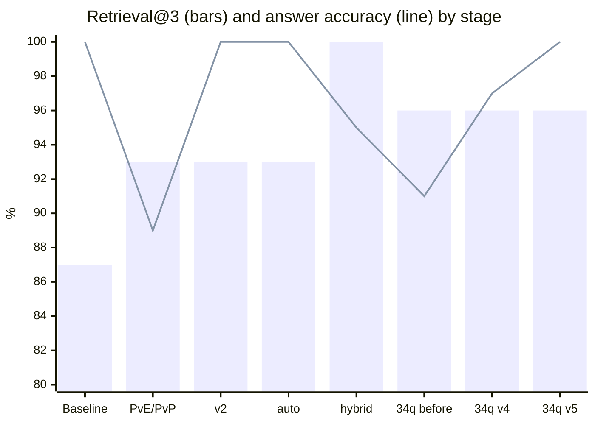

# FF14 Patch Notes Q&A

[](https://github.com/ysk-rk/ff14-patch-qa/actions/workflows/test.yml)

[日本語](README.md)

A Q&A app (RAG) that answers questions about the FINAL FANTASY XIV: Dawntrail patch notes (7.0–7.57), with sources.


### Demo
https://github.com/user-attachments/assets/f3cdd3a4-9259-4b56-bdea-b8b35b8c8b7a


The app and its data are in Japanese.

## The problem

Each patch overwrites parts of earlier patches. For example, one skill's damage falloff for secondary targets went from 65% to 50% in 7.2, to 35% in 7.25, and to 25% in 7.3.

If you simply pass the patch notes to an LLM and ask a question, it sometimes **answers with a value from an intermediate patch**. The main goal of this app is to reduce these "outdated answer" errors.

```text
Q: What is the damage falloff for Machinist's Excavator on secondary targets?

[Current value] 25% (source: Patch 7.3)
[History]
- Patch 7.2: 65% → 50%
- Patch 7.25: 50% → 35%
- Patch 7.3: 35% → 25%
```

## Results

### Dev set (used for tuning)

Measured while adding one improvement at a time (answers generated with gemini-3.5-flash-lite). Along the way, the used-up test questions and four new "what changed?" questions were added, taking the set from 20 to 34 questions.

| Stage | Questions | Retrieval@3 | Correct answers |
| --- | --- | --- | --- |
| Baseline | 20 | 87% | 19/19 *1 |
| PvE/PvP filtering | 20 | 93% | 17/19 |
| Prompt v2 (write out the change history first) | 20 | 93% | 19/19 *1 |
| Prompt auto (question type and current value decided in code) | 20 | 93% | 20/20 |
| Hybrid search | 20 | 100% | 19/20 *2 |
| Expanded to 34 questions (baseline before the fix) | 34 | 96% | 31/34 |
| History prompt v4 | 34 | 96% | 33/34 *2 |
| Current-value prompt v5 (final) | 34 | 96% | 34/34 |



\*1 The one "what changed?" question was not scored at this point. Once it was scored, it turned out that v2 had stopped answering it (see below).

\*2 The one miss (q018) was answered "not found" even though the correct source was the top search result. Fixed by v5 (see below).

Later, the second held-out set was also moved into the dev set, bringing it to 44 questions. Only retrieval has been measured on all 44 so far: Retrieval@3 is 97% and Retrieval@8 (the 8 chunks passed to the LLM) is 100%. Answer accuracy will be measured with the next improvement.

- **Retrieval@3**: share of required source patches found in the top 3 search results
- **Correct answers**: current-value questions must give the right number; "what changed?" questions must mention every required patch; unanswerable questions must answer "not found"

### Held-out test sets (never used for tuning)

Ten questions were committed before any results were seen, and run after the configuration was fixed.

| Round | Configuration | Model | Correct answers | Retrieval@3 |
| --- | --- | --- | --- | --- |
| 1st (t001–t010) | auto + hybrid | gemini-3.5-flash-lite | 10/10 | 93% |
| 1st (t001–t010) | auto + hybrid | gemini-3.8-flash | 6/7 *3 | 93% |
| 2nd (n001–n010) | v4 + hybrid | gemini-3.5-flash-lite | 10/10 | 100% |
| 2nd (n001–n010) | v4, v5 + hybrid | gemini-3.5-flash-lite | 10/10 | 100% |
| 2nd (n001–n010) | v4, v5 + hybrid | gemini-3.8-flash | not measured *4 | – |
| 3rd (m001–m010) | – | – | not run yet *5 | – |

\*3 Three questions got no answer because of API rate limits and were not re-run. The one miss was a "what changed?" question: the answer left out intermediate changes that a later patch had overwritten. This led to prompt v4 (see below).

\*4 Four attempts between Nov 3 and Nov 5 got no answers because of free-tier server load (503) and rate limits (429), so this was put on hold.

\*5 Includes three questions shaped like q018. It will be run once the next improvement is finalized.

## How it works

```text
Lodestone patch notes (23 pages)
  → extract text and tables, split into chunks (2,932)
  → embeddings (multilingual-e5-small) + Chroma
  → search: filter by PvE/PvP, combine semantic and keyword matching
  → choose a prompt from the question's wording: v5 for "current value", v4 for "what changed"
  → answer with an LLM (llm.py; currently Gemini, falling back to a lighter model when busy)
  → recompute the current value in code: take the "after" value of the newest patch in the history
```

| Role | Tools |
| --- | --- |
| Backend | Python 3.12, FastAPI |
| Search | sentence-transformers (multilingual-e5-small), Chroma, rank-bm25 |
| Answers | Gemini API (free tier). The LLM layer is built so the provider can be swapped |
| Frontend | TypeScript, React, Vite |
| Tests | pytest, GitHub Actions |

## What I focused on

### 1. Checking the data by hand surfaced two bugs

- **Wrong heading hierarchy**: In the Lodestone HTML, the top-level sections (such as "Battle") are `h3` elements with a specific class, not `h2`. Deciding the level by tag name alone attached an unrelated "Other" section to PvE job changes.
- **Heading-only items were dropped**: Items whose heading *is* the change (e.g. "The desynthesis skill cap is raised from 720 to 740") had no body text and were missing from the chunks. Fixing this took the count from 2,195 to 2,932 chunks; **about a quarter of the data had been missing**.

### 2. The dev set includes a "different attribute changed later" trap

A skill's potency may have last changed in 7.2 while its falloff last changed in 7.5. A model that just looks for "the newest patch" will cite a patch that never touched the attribute being asked about. Ten of the 44 dev questions have this shape.

Expected answers were verified by checking that each patch's "before" value matches the previous patch's "after" value; a missed change would break the chain.

### 3. Moving what the LLM is bad at into code

With a small model, small wording changes in the prompt fixed one question and broke another.

| Prompt | What happened |
| --- | --- |
| v2 | Better at current values, but started answering "not found" to "what changed?" |
| v3 (let the LLM classify the question) | Fixed "what changed?", but broke two current-value questions |

So the **question type** and the **final step of picking the current value from the history** are now decided in code (prompt "auto"). The LLM only writes out the change history from the sources.

### 4. Unscored questions hide regressions

The "what changed?" question was initially left unscored because it is hard to grade automatically. Meanwhile, v2 had stopped answering it, and I only noticed when trying it in the UI. It is now scored by checking that every required patch number appears in the answer.

### 5. A separate held-out test set

All improvements were chosen while looking at the dev questions, so they may only work for those questions. A separate set of 10 test questions was therefore kept aside, never used for tuning, and run after the configuration was fixed. The test questions were committed before any results were seen.

The first test round surfaced a failure the dev set had not shown. On a "what changed?" question, gemini-3.8-flash left out intermediate changes that a later patch had overwritten. The answer began with "summarizing the latest information", which suggests the model applied the "prefer the newest patch" rule to a history question too.

### 6. Rebuilding the question sets before fixing the problem

Once the test results had been seen, those questions could no longer serve as a held-out check. So, **before changing anything**, I:

1. moved the used-up test questions into the dev set
2. added four dev questions where the same attribute is changed and later overwritten
3. wrote a new set of 10 test questions with the same shapes, and committed it
4. fixed the acceptance criteria in advance (all history questions correct, no new misses elsewhere)

The baseline showed the smaller model failing two history questions as well, with answers starting "here is the latest information". The rule causing this is still needed for current-value questions, so I created **v4, which swaps that one rule for "do not omit changes that were later overwritten; list every change in patch order", and is used only for history questions**. The current-value prompt was not changed at all.

Results went from 31/34 to 33/34, and history questions from 4/6 to 6/6. The new test set scored 10/10. However, the four history questions in the test set might have been answered correctly by the old prompt too; the clear evidence for v4 comes from the two dev questions.

### 7. Debugging without calling the LLM, and fixing in the prompt instead of retrieval

The last remaining miss (q018) was "What is the max charges of PvP Paladin's Holy Spirit?". The correct source (7.3, 1 → 2) was the top search result, yet the answer was "not found".

A script that prints the sources and prompt without calling the LLM showed that the 7th source was **a different job's (Gunbreaker) "max charges 2 → 3"**, from a newer patch (7.35). The model was likely torn between "use the newest patch" and "this is a different job", and gave up.

Filtering other jobs out of retrieval pushed out a source another question needed, so it was reverted (see the table below). Instead, I created **v5, which keeps the sources as they are and adds to the current-value prompt: "do not use sources about other jobs or skills, even if they mention the same attribute"**. q018 then answered "2 (source: Patch 7.3)", reaching 34/34. The test set stayed at 10/10.

However, the second held-out set had no question shaped like q018. So I wrote a script that searches the data for places where a different job has a newer change to the same attribute. After confirming that it finds q018 itself, I used it to put three such questions into the third held-out set (two PvP, one PvE; not run yet).

### 8. Changes I tried and reverted

Changes that did not meet the pre-set criteria were reverted and documented.

| Change | Goal | Why it was reverted |
| --- | --- | --- |
| Split multiple changes in one table cell into separate rows | Stop the second change from being missed | Another question's source dropped out of the top 3 |
| Filter retrieval by the job named in the question | Stop the LLM from being confused by a similar change for another job (q018) | Another question's required history source was pushed out of the top 8 |

In both cases, a change that fixed one question pushed out a source another question needed. Only 8 chunks are passed to the LLM, so removing one lets another one in.

### 9. Separating the LLM layer so other models can be compared

On the free tier, gemini-3.8-flash often returns no answer because of load and rate limits, so the v4 and v5 improvements have not been verified on it. To make it possible to compare a paid model or another provider's model, the LLM calls were moved into `backend/app/llm.py`.

- Each provider is one class, and `LLM_PROVIDER` in `.env` selects which one to use (only Gemini for now)
- The fallback to the next model on busy errors is tested with a fake provider, without calling any LLM
- Adding a provider only means adding one class to llm.py; search, prompts, grading and the UI stay the same

## Running locally

### Requirements

- Python 3.12
- Node.js 20+
- A Gemini API key (free at [Google AI Studio](https://aistudio.google.com/app/apikey))

### Backend

```powershell
cd backend
py -3.12 -m venv .venv
.venv\Scripts\Activate.ps1
pip install -r requirements.txt
```

Create `backend/.env` with your API key:

```text
GEMINI_API_KEY=(your key)
# Optional (defaults to gemini)
LLM_PROVIDER=gemini
```

Fetch the patch notes and build the search index (the fetcher downloads 23 pages once, 5 seconds apart):

```powershell
python scripts\fetch_lodestone.py
python scripts\extract_chunks.py
python scripts\build_index.py
```

Start the API:

```powershell
python -m uvicorn app.main:app --reload
```

### Frontend

```powershell
cd frontend
npm install
npm run dev
```

Open http://localhost:5173.

### Tests and evaluation

```powershell
cd backend
python -m pytest
python scripts\run_eval.py --prompt auto --search hybrid
python scripts\run_eval.py --search hybrid --search-only
python scripts\show_context.py "PvPのナイトのホーリースピリットの最大チャージ数は？"
```

- `--search-only` measures retrieval without calling the LLM, so it does not use any API quota.
- `show_context.py` prints the sources and prompt that would be sent to the LLM, without calling it. Useful for debugging a wrong answer.
- The held-out set can be run with `--questions ..\eval\test_questions.jsonl`. Please don't use it to make tuning decisions.

## About the data

- The patch notes are © SQUARE ENIX. This repository does not include their text; it only contains the fetching scripts and links to the original pages.
- Before fetching, I checked the Lodestone guidelines and the FINAL FANTASY XIV Terms of Service. To avoid load on the site, the 23 pages are fetched once, 5 seconds apart, and saved pages are never fetched again.
- Content sent to the Gemini API free tier may be used by Google to improve its services. This app only sends public patch notes and the user's question.

## Known limitations

- It is not yet verified that v5 works in general for questions shaped like q018 (a newer change to the same attribute for a different job). Three such questions are in the third held-out set (m001–m003) and will be run once the next improvement is finalized
- The v4 and v5 improvements have not yet been verified with gemini-3.8-flash (free-tier load and rate limits)
- When one table cell contains two changes, the second one is sometimes missed
- The question type is decided by keyword matching, so unexpected phrasings can be misclassified
- Grading only checks that the right numbers or patch numbers appear in the answer; it does not verify that the history itself is correct
- On the Gemini API free tier, busy servers (503) and rate limits (429) can prevent an answer
- New patch notes are not ingested automatically

## Documentation (Japanese)

- [Specification](docs/spec.md)
- [Design](docs/design.md)
- [Development notes](docs/notes.md)