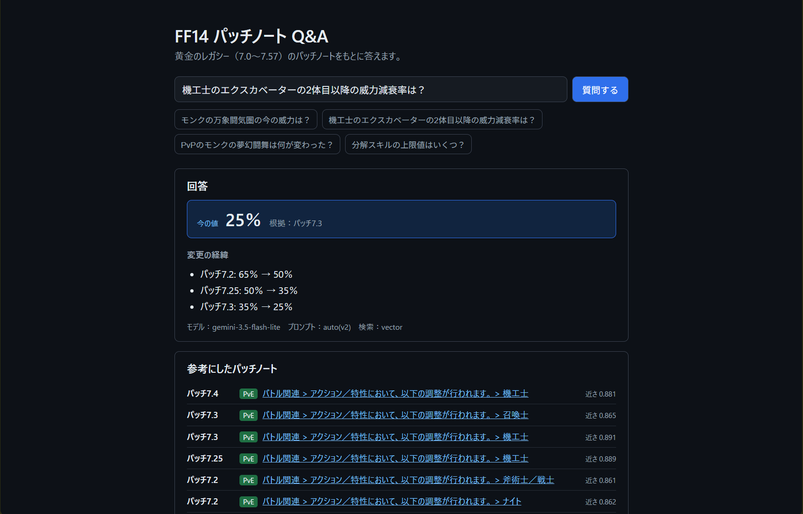

# FF14 Patch Notes Q&A

[日本語](README.md)

A Q&A app (RAG) that answers questions about the FINAL FANTASY XIV: Dawntrail patch notes (7.0–7.57), with sources.



The app and its data are in Japanese.

## The problem

Each patch overwrites parts of earlier patches. For example, one skill's damage falloff for secondary targets went from 65% to 50% in 7.2, to 35% in 7.25, and to 25% in 7.3.

If you simply pass the patch notes to an LLM and ask a question, it sometimes **answers with a value from an intermediate patch**. The main goal of this app is to reduce these "outdated answer" errors.

```text
Q: What is the damage falloff for Machinist's Excavator on secondary targets?

[Current value] 25% (source: Patch 7.3)
[History]
- Patch 7.2: 65% → 50%
- Patch 7.25: 50% → 35%
- Patch 7.3: 35% → 25%
```

## Results

### Dev set (20 questions, used for tuning)

Measured while adding one improvement at a time (answers generated with gemini-3.5-flash-lite).

| Stage | Retrieval@3 | Correct answers |
| --- | --- | --- |
| Baseline | 87% | 19/19 *1 |
| PvE/PvP filtering | 93% | 17/19 |
| Prompt v2 (write out the change history first) | 93% | 19/19 *1 |
| Prompt auto (question type and current value decided in code) | 93% | 20/20 |
| Hybrid search (final) | 100% | 19/20 *2 |

\*1 The one "what changed?" question was not scored at this point. Once it was scored, it turned out that v2 had stopped answering it (see below).

\*2 One question was answered "not found" even though the correct source was the top search result (see Known limitations). With gemini-3.8-flash, the final configuration answered all 16 questions it responded to correctly (4 failed with API rate-limit errors).

- **Retrieval@3**: share of required source patches found in the top 3 search results
- **Correct answers**: current-value questions must give the right number; "what changed?" questions must mention every required patch; unanswerable questions must answer "not found"

### Held-out test set (10 questions, never used for tuning)

Run once, after the final configuration was fixed.

| Model | Correct answers | Retrieval@3 | Retrieval@8 |
| --- | --- | --- | --- |
| gemini-3.5-flash-lite | 10/10 | 93% | 100% |
| gemini-3.8-flash | 6/7 *3 | 93% | 100% |

\*3 Three questions got no answer because of API rate limits and were not re-run. The one miss was a "what changed?" question: the answer left out intermediate changes that a later patch had overwritten (see below).

## How it works

```text
Lodestone patch notes (23 pages)
  → extract text and tables, split into chunks (2,932)
  → embeddings (multilingual-e5-small) + Chroma
  → search: filter by PvE/PvP, combine semantic and keyword matching
  → choose a prompt: "current value" or "what changed", based on the question's wording
  → answer with Gemini (falls back to a lighter model when busy)
  → recompute the current value in code: take the "after" value of the newest patch in the history
```

| Role | Tools |
| --- | --- |
| Backend | Python 3.12, FastAPI |
| Search | sentence-transformers (multilingual-e5-small), Chroma, rank-bm25 |
| Answers | Gemini API (free tier) |
| Frontend | TypeScript, React, Vite |
| Tests | pytest, GitHub Actions |

## What I focused on

### 1. Checking the data by hand surfaced two bugs

- **Wrong heading hierarchy**: In the Lodestone HTML, the top-level sections (such as "Battle") are `h3` elements with a specific class, not `h2`. Deciding the level by tag name alone attached an unrelated "Other" section to PvE job changes.
- **Heading-only items were dropped**: Items whose heading *is* the change (e.g. "The desynthesis skill cap is raised from 720 to 740") had no body text and were missing from the chunks. Fixing this took the count from 2,195 to 2,932 chunks; **about a quarter of the data had been missing**.

### 2. The dev set includes a "different attribute changed later" trap

A skill's potency may have last changed in 7.2 while its falloff last changed in 7.5. A model that just looks for "the newest patch" will cite a patch that never touched the attribute being asked about. Five of the 20 dev questions have this shape.

Expected answers were verified by checking that each patch's "before" value matches the previous patch's "after" value; a missed change would break the chain.

### 3. Moving what the LLM is bad at into code

With a small model, small wording changes in the prompt fixed one question and broke another.

| Prompt | What happened |
| --- | --- |
| v2 | Better at current values, but started answering "not found" to "what changed?" |
| v3 (let the LLM classify the question) | Fixed "what changed?", but broke two current-value questions |

So the **question type** and the **final step of picking the current value from the history** are now decided in code (prompt "auto"). The LLM only writes out the change history from the sources.

### 4. Unscored questions hide regressions

The "what changed?" question was initially left unscored because it is hard to grade automatically. Meanwhile, v2 had stopped answering it, and I only noticed when trying it in the UI. It is now scored by checking that every required patch number appears in the answer.

### 5. A separate held-out test set

All improvements were chosen while looking at the 20 dev questions, so they may only work for those questions. A separate set of 10 test questions was therefore kept aside, never used for tuning, and run once after the final configuration was fixed. The test questions were committed before any results were seen.

It did surface a failure the dev set had not shown. On a "what changed?" question, gemini-3.8-flash left out intermediate changes that a later patch had overwritten. The answer began with "summarizing the latest information", which suggests the model applied the "prefer the newest patch" rule to a history question too. As decided in advance, I did not tune on this result; it is recorded as a known limitation.

## Running locally

### Requirements

- Python 3.12
- Node.js 20+
- A Gemini API key (free at [Google AI Studio](https://aistudio.google.com/app/apikey))

### Backend

```powershell
cd backend
py -3.12 -m venv .venv
.venv\Scripts\Activate.ps1
pip install -r requirements.txt
```

Create `backend/.env` with your API key:

```text
GEMINI_API_KEY=(your key)
```

Fetch the patch notes and build the search index (the fetcher downloads 23 pages once, 5 seconds apart):

```powershell
python scripts\fetch_lodestone.py
python scripts\extract_chunks.py
python scripts\build_index.py
```

Start the API:

```powershell
python -m uvicorn app.main:app --reload
```

### Frontend

```powershell
cd frontend
npm install
npm run dev
```

Open http://localhost:5173.

### Tests and evaluation

```powershell
cd backend
python -m pytest
python scripts\run_eval.py --prompt auto --search hybrid
python scripts\run_eval.py --search hybrid --search-only
```

`--search-only` measures retrieval without calling the LLM, so it does not use any API quota.

The held-out set can be run with `--questions ..\eval\test_questions.jsonl`. Please don't use it to make tuning decisions.

## About the data

- The patch notes are © SQUARE ENIX. This repository does not include their text; it only contains the fetching scripts and links to the original pages.
- Before fetching, I checked the Lodestone guidelines and the FINAL FANTASY XIV Terms of Service. To avoid load on the site, the 23 pages are fetched once, 5 seconds apart, and saved pages are never fetched again.
- Content sent to the Gemini API free tier may be used by Google to improve its services. This app only sends public patch notes and the user's question.

## Known limitations

- The model sometimes answers "not found" even when the answer is in the sources. With the smaller model, a slight change in which chunks are retrieved can trigger this
- The "prefer the newest patch" rule is sometimes applied to history questions, so intermediate changes that were later overwritten are left out
- When one table cell contains two changes, the second one is sometimes missed
- The question type is decided by keyword matching, so unexpected phrasings can be misclassified
- On the Gemini API free tier, busy servers (503) and rate limits (429) can prevent an answer
- New patch notes are not ingested automatically

## Documentation (Japanese)

- [Specification](docs/spec.md)
- [Design](docs/design.md)
- [Development notes](docs/notes.md)