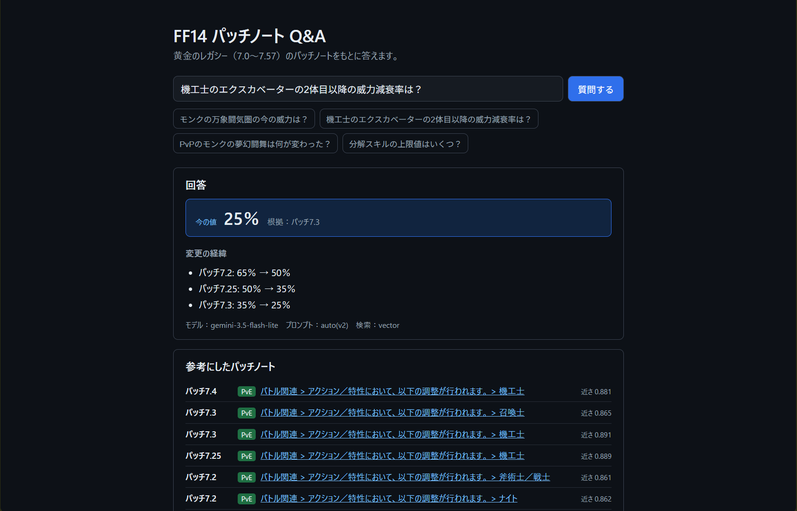
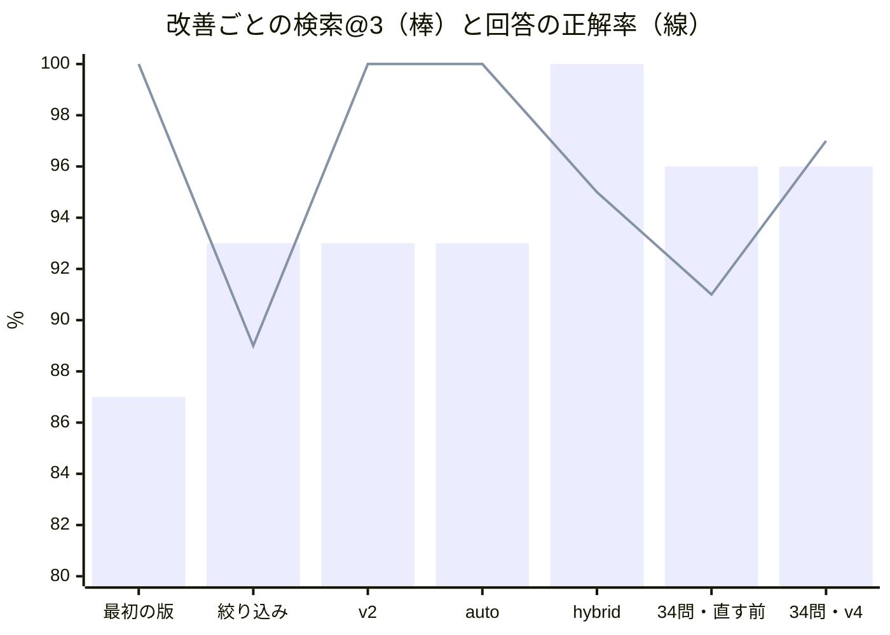

# FF14 パッチノート Q&A

[](https://github.com/ysk-rk/ff14-patch-qa/actions/workflows/test.yml)

[English](README.en.md)

FINAL FANTASY XIV 黄金のレガシー（パッチ 7.0〜7.57）のパッチノートをもとに、質問に出典付きで答える Q&A アプリ（RAG）です。



## 何を解決するか

パッチノートは、新しいパッチが古い内容を上書きしていきます。たとえば、あるスキルの「2体目以降の威力減衰率」は、7.2 で 65％ → 50％、7.25 で 50％ → 35％、7.3 で 35％ → 25％ と変わっています。

AI にパッチノートを渡して質問するだけでは、**途中のパッチの値を今の値として答えてしまう**ことがあります。このアプリでは、この「古い情報で答える」失敗を減らすことを一番の目標にしました。

```text
質問: 機工士のエクスカベーターの2体目以降の威力減衰率は？

【今の値】25％（根拠: パッチ7.3）
【変更の経緯】
- パッチ7.2: 65％ → 50％
- パッチ7.25: 50％ → 35％
- パッチ7.3: 35％ → 25％
```

## 結果

### 評価用の問題（改善に使った問題）

改善を1つずつ加えながら測りました（回答は gemini-3.5-flash-lite に固定）。途中で、使い終わったテスト用の10問と、経緯の質問4問を足して、20問から34問にしました。

| 段階 | 問題数 | 検索@3 | 回答の正解 |
| --- | --- | --- | --- |
| 最初の版 | 20 | 87％ | 19/19 ※1 |
| PvE／PvP の絞り込み | 20 | 93％ | 17/19 |
| プロンプト v2（経緯を書き出させる） | 20 | 93％ | 19/19 ※1 |
| プロンプト auto（種類と今の値をコードで決める） | 20 | 93％ | 20/20 |
| ハイブリッド検索 | 20 | 100％ | 19/20 ※2 |
| 問題を34問に増やす（直す前の基準） | 34 | 96％ | 31/34 |
| 経緯の質問用のプロンプト v4（最終形） | 34 | 96％ | 33/34 ※2 |



※1 「何が変わったか」を聞く質問（1問）は、この時点では採点の対象外でした。採点するようにしたところ、v2 では答えられなくなっていたことが分かりました（後述）。

※2 ✕の1問（q018）は、正解の資料が検索の1位にあるのに「分かりませんでした」と答えました（「分かっている課題」を参照）。

- **検索@3**: 正解に必要なパッチの資料が、検索の上位3件に入った割合
- **回答の正解**: 今の値の質問は正しい数字を答えたか、「何が変わったか」の質問は必要なパッチ番号がすべて入っているか、答えられない質問は「分かりませんでした」と答えたかで採点

### テスト用の問題（改善に使っていない問題）

改善を決めるのに使わない10問を、結果を見る前にコミットしておき、最終形が決まってから流しました。

| 回 | 形 | モデル | 回答の正解 | 検索@3 |
| --- | --- | --- | --- | --- |
| 1回目（t001〜t010） | auto ＋ hybrid | gemini-3.5-flash-lite | 10/10 | 93％ |
| 1回目（t001〜t010） | auto ＋ hybrid | gemini-3.8-flash | 6/7 ※3 | 93％ |
| 2回目（n001〜n010） | v4 ＋ hybrid | gemini-3.5-flash-lite | 10/10 | 100％ |
| 2回目（n001〜n010） | v4 ＋ hybrid | gemini-3.8-flash | 未測定 ※4 | － |

※3 3問は API の回数制限で答えが出ず、流し直していません。✕の1問は「何が変わったか」の質問で、あとのパッチで上書きされた途中の変更を書き落としました。これが v4 を作るきっかけになりました（後述）。

※4 無料枠の混雑（503）と回数制限（429）で、まだ答えが出ていません。

## しくみ

```text
ロードストーンのパッチノート（23本）
  → 本文と表を取り出して分割（2,932チャンク）
  → 埋め込み（multilingual-e5-small）＋ Chroma
  → 検索: PvE／PvP で絞り込み、意味の近さとキーワードの一致を合わせる
  → プロンプトを選ぶ: 質問の言葉で判定し、「今の値」なら v2、「何が変わったか」なら v4
  → Gemini で回答（混雑しているときは軽いモデルに切り替える）
  → 今の値をコードで決め直す: 経緯の中で一番新しいパッチの「変更後」を使う
```

| 役割 | 使うもの |
| --- | --- |
| バックエンド | Python 3.12、FastAPI |
| 検索 | sentence-transformers（multilingual-e5-small）、Chroma、rank-bm25 |
| 回答 | Gemini API（無料枠） |
| フロントエンド | TypeScript、React、Vite |
| テスト | pytest、GitHub Actions |

## 工夫したところ

### 1. データを自分の目で確かめて、2つの不具合を見つけた

- **見出しの階層の取り違え**: ロードストーンの HTML では、一番上の分類（「バトル関連」など）が h2 ではなく class 付きの h3 でした。タグ名だけで階層を決めていたため、PvE のジョブ調整に前の分類の「その他」が付いていました。
- **見出しだけの項目が消えていた**: 「分解スキルの上限値が 720 → 740 に引き上げられます」のように、見出しそのものが変更内容になっている項目が、チャンクに入っていませんでした。直したところ、2,195 → 2,932 チャンクと、**約4分の1が抜けていた**ことが分かりました。

### 2. 「後のパッチで別の項目だけが変わる」わなを、評価用の質問に入れた

あるスキルの威力の最後の変更は 7.2、減衰率の最後の変更は 7.5、ということがあります。「一番新しいパッチを見ればいい」と考えると、威力を聞かれたのに減衰率しか変わっていないパッチを根拠にしてしまいます。評価用の質問のうち8問を、この形にしています。

正解は、パッチごとの「変更前」と「変更後」の数字がつながっているかで確かめています。間に見落とした調整があれば、ここがずれます。

### 3. AI が苦手なことは、コードに任せた

軽いモデルでは、プロンプトの言い回しを少し変えるだけで、ある質問が直る代わりに別の質問が崩れました。

| プロンプト | 起きたこと |
| --- | --- |
| v2 | 今の値の質問には強くなったが、「何が変わった？」に「分かりませんでした」と答えるようになった |
| v3（質問の種類を AI に決めさせる） | 「何が変わった？」は直ったが、今の値の質問が2問崩れた |

そこで、**質問の種類**と、**経緯から今の値を選ぶ最後の一歩**を、コードで決めるようにしました（プロンプト auto）。AI には、資料から変更の経緯を書き出すところまでを任せています。

### 4. 採点していない質問では、悪くなっても気づけない

「何が変わったか」の質問は、最初は機械で採点できないので対象外にしていました。その間に v2 で答えられなくなっていたことに、画面で試すまで気づけませんでした。今は、必要なパッチ番号がすべて回答に入っているかで採点しています。

### 5. 評価を2つに分けた

改善は、評価用の問題の結果を見ながら決めました。そのため、その問題だけに効く直し方になっている可能性があります。そこで、**結果を見て直すのには使わないテスト用の10問**を別に用意し、最終形が決まってから流しました。テスト用の質問は、結果を見る前にコミットしています。

1回目のテストで、評価用の問題では出なかった失敗が見つかりました。「何が変わった？」という質問で、gemini-3.8-flash が、あとのパッチで上書きされた途中の変更を書き落としました。回答の最初に「最新の情報としてまとめると」とあったので、「新しいパッチの値を優先する」ルールを、経緯の質問にもあてはめたと考えられます。

### 6. 見つけた課題は、問題を作り直してから直した

テスト用の問題は、もう結果を見てしまったので、直したあとの確認には使えません。そこで、**直す前に**次の準備をしました。

1. 使い終わったテスト用の10問を、評価用に移す
2. 同じ項目が途中で上書きされる経緯の質問を、評価用に4問足す
3. 同じ形の別の問題で、新しいテスト用の10問を作り、コミットする
4. 判断の基準（経緯の質問がすべて◯、ほかの✕が増えない）を、先に決めておく

直す前の基準を測ると、軽いモデルでも経緯の質問が2問✕で、回答に「最新の情報は以下の通りです」とありました。原因のルールは、今の値の質問には必要です。なので、**経緯の質問のときだけ、そのルールを「上書きされた変更も省略せず、古い順にすべて書く」に入れ替えた** v4 を作りました。今の値の質問のプロンプト（v2）は、1文字も変えていません。

結果は 31/34 → 33/34 で、経緯の質問は 4/6 → 6/6 になりました。新しいテスト用の10問も 10/10 でした。ただし、経緯のテスト用の4問は、前のプロンプトでも答えられた可能性があります。v4 の効果がはっきり言えるのは、評価用の2問です。

### 7. 試して、取り消した変更

先に決めた基準を満たさなかった変更は、取り消して記録に残しています。

| 変更 | 狙い | 取り消した理由 |
| --- | --- | --- |
| 1つのセルに書かれた複数の変更を、行に分ける | 2つ目の変更の読み落としを防ぐ | 別の問題の資料が、検索の上位3件から外れた |
| 質問のジョブで検索を絞り込む | 別のジョブの似た変更に AI が迷うのを防ぐ（q018） | 別の問題で、経緯に必要な資料が上位8件から押し出された |

どちらも、1問を直す変更が、別の問題の資料を押し出しました。AI に渡せる資料は8件しかないので、1件を外すと別の1件が入ってきます。

## 動かし方

### 必要なもの

- Python 3.12
- Node.js 20 以上
- Gemini API のキー（[Google AI Studio](https://aistudio.google.com/app/apikey) で無料で作れます）

### バックエンド

```powershell
cd backend
py -3.12 -m venv .venv
.venv\Scripts\Activate.ps1
pip install -r requirements.txt
```

`backend/.env` を作り、API キーを書きます。

```text
GEMINI_API_KEY=（あなたのキー）
```

パッチノートを取得して、検索用のデータを作ります（取得は23ページを5秒間隔で1回だけ行います）。

```powershell
python scripts\fetch_lodestone.py
python scripts\extract_chunks.py
python scripts\build_index.py
```

API を起動します。

```powershell
python -m uvicorn app.main:app --reload
```

### フロントエンド

```powershell
cd frontend
npm install
npm run dev
```

http://localhost:5173 を開きます。

### テストと評価

```powershell
cd backend
python -m pytest
python scripts\run_eval.py --prompt auto --search hybrid
python scripts\run_eval.py --search hybrid --search-only
python scripts\show_context.py "PvPのナイトのホーリースピリットの最大チャージ数は？"
```

- `--search-only` は AI を使わずに検索だけを測るので、API の回数制限を使いません。
- `show_context.py` は、AI に渡す資料とプロンプトを、AI を呼ばずに表示します。答えがおかしいときの原因を調べるのに使います。
- テスト用の10問は `--questions ..\eval\test_questions.jsonl` で流せます。改善の判断には使わないでください。

## データについて

- パッチノートの著作権は株式会社スクウェア・エニックスにあります。このリポジトリには本文を含めず、取得するスクリプトと元記事へのリンクだけを置いています。
- 取得の前に、The Lodestone のガイドラインと FINAL FANTASY XIV 利用規約を確認しました。サイトへの負荷を避けるため、23ページを5秒間隔で1回だけ取得し、保存済みのページは取りに行きません。
- Gemini API の無料枠に送った内容は、Google のサービス改善に使われることがあります。このアプリが送るのは、公開されているパッチノートと質問だけです。

## 分かっている課題

- 資料に答えがあるのに「分かりませんでした」と答えることがある。q018 では、同じ「最大チャージ数」の変更が、より新しいパッチで別のジョブにあったのが原因と考えられる。ジョブで検索を絞り込む方法は、試して取り消した
- v4 の改善は、gemini-3.8-flash ではまだ確かめていない（無料枠の混雑と回数制限のため）
- 1つのセルに2つの変更が書かれていると、2つ目を読み落とすことがある
- 質問の種類は言葉の一致で決めているため、想定と違う言い回しだと間違えることがある
- 採点は、数字やパッチ番号が回答に入っているかだけを見ている。経緯の内容が正しいかまでは見ていない
- Gemini API の無料枠では、混雑（503）や回数制限（429）で答えが出ないことがある
- 新しいパッチノートは、自動では取り込まない

## ドキュメント

- [仕様書](docs/spec.md)
- [設計書](docs/design.md)
- [開発メモ](docs/notes.md)（日付順の記録）