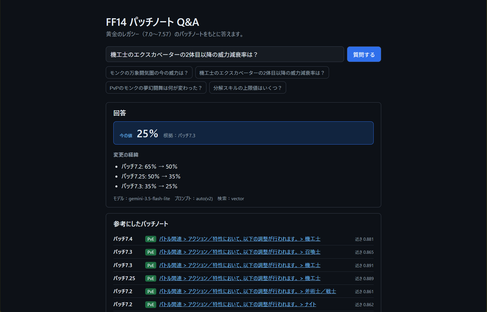
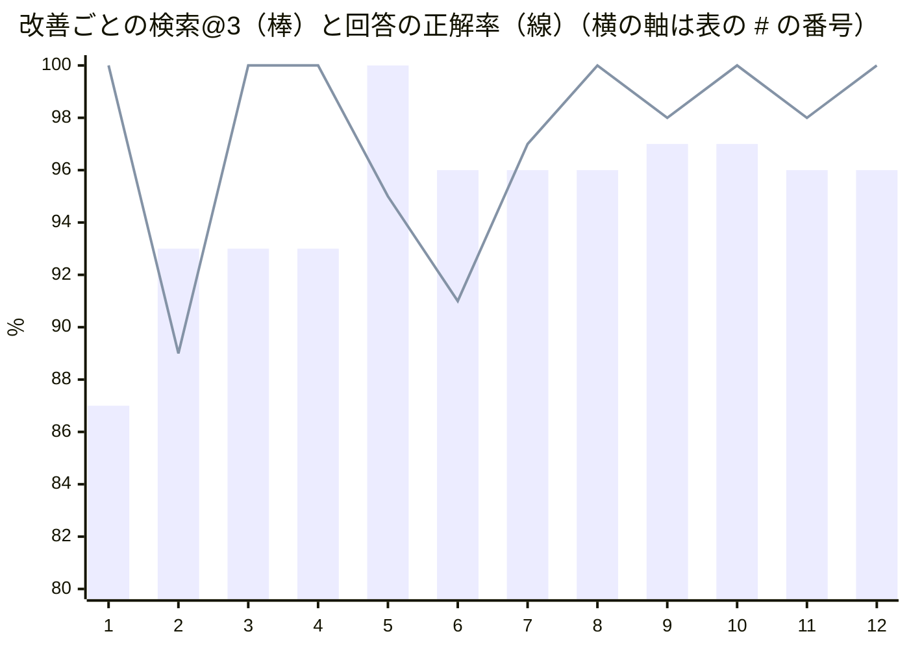

# FF14 パッチノート Q&A

[](https://github.com/ysk-rk/ff14-patch-qa/actions/workflows/test.yml)

[English](README.en.md)

FINAL FANTASY XIV 黄金のレガシー（パッチ 7.0〜7.57）のパッチノートをもとに、質問に出典付きで答える Q&A アプリ（RAG）です。



### デモ
https://github.com/user-attachments/assets/c81d9cdb-f51d-401c-a6c1-d7f66d8ee39f


## 何を解決するか

パッチノートは、新しいパッチが古い内容を上書きしていきます。たとえば、あるスキルの「2体目以降の威力減衰率」は、7.2 で 65％ → 50％、7.25 で 50％ → 35％、7.3 で 35％ → 25％ と変わっています。

AI にパッチノートを渡して質問するだけでは、**途中のパッチの値を今の値として答えてしまう**ことがあります。このアプリでは、この「古い情報で答える」失敗を減らすことを一番の目標にしました。

```text
質問: 機工士のエクスカベーターの2体目以降の威力減衰率は？

【今の値】25％（根拠: パッチ7.3）
【変更の経緯】
- パッチ7.2: 65％ → 50％
- パッチ7.25: 50％ → 35％
- パッチ7.3: 35％ → 25％
```

## 結果

### 評価用の問題（改善に使った問題）

改善を1つずつ加えながら測りました（回答は gemini-3.5-flash-lite に固定）。使い終わったテスト用の問題や、経緯の質問を足しながら、20問から54問に増やしました。

| # | 段階 | 問題数 | 検索@3 | 回答の正解 |
| --- | --- | --- | --- | --- |
| 1 | 最初の版 | 20 | 87％ | 19/19 ※1 |
| 2 | PvE／PvP の絞り込み | 20 | 93％ | 17/19 |
| 3 | プロンプト v2（経緯を書き出させる） | 20 | 93％ | 19/19 ※1 |
| 4 | プロンプト auto（種類と今の値をコードで決める） | 20 | 93％ | 20/20 |
| 5 | ハイブリッド検索 | 20 | 100％ | 19/20 ※2 |
| 6 | 問題を34問に増やす（直す前の基準） | 34 | 96％ | 31/34 |
| 7 | 経緯の質問用のプロンプト v4 | 34 | 96％ | 33/34 ※2 |
| 8 | 今の値の質問用のプロンプト v5 | 34 | 96％ | 34/34 |
| 9 | 問題を44問に増やす（直す前の基準） | 44 | 97％ | 43/44 ※2 |
| 10 | 質問のジョブと合う資料の順位を上げる | 44 | 97％ | 44/44 |
| 11 | 問題を54問に増やす（直す前の基準） | 54 | 96％ | 53/54 ※3 |
| 12 | 長いチャンクを埋め込みのときだけ分ける（最終形） | 54 | 96％ | 54/54 |



※1 「何が変わったか」を聞く質問（1問）は、この時点では採点の対象外でした。採点するようにしたところ、v2 では答えられなくなっていたことが分かりました（後述）。

※2 ✕の1問（q018、44問では n005）は、正解の資料が検索の上位にあるのに「分かりませんでした」と答えました。どちらも、別のジョブの同じ項目の資料が上位に入っていました（後述）。

※3 ✕の1問（m007）は、正解の資料が検索の上位8件に入らなかった失敗です。埋め込みのモデルが、長い資料の後ろのほうを読んでいませんでした（後述）。

今は、4回目のテスト用の10問を評価用に移し、さらに「質問にジョブ名があり、正解がロールの調整にある」4問（c001〜c004）を足して、68問にしています。68問は検索だけを測り、検索@3 が 93％、検索@8（AI に渡す8件）が 98％ でした。検索@8 が 100％ にならないのは、c003 の正解の資料が上位8件に入らないためです（後述）。

- **検索@3**: 正解に必要なパッチの資料が、検索の上位3件に入った割合
- **回答の正解**: 今の値の質問は正しい数字を答えたか、「何が変わったか」の質問は必要なパッチ番号がすべて入っているか、答えられない質問は「分かりませんでした」と答えたかで採点

### テスト用の問題（改善に使っていない問題）

改善を決めるのに使わない10問を、結果を見る前にコミットしておき、最終形が決まってから流しました。

| 回 | 形 | モデル | 回答の正解 | 検索@3 |
| --- | --- | --- | --- | --- |
| 1回目（t001〜t010） | auto ＋ hybrid | gemini-3.5-flash-lite | 10/10 | 93％ |
| 1回目（t001〜t010） | auto ＋ hybrid | gemini-3.8-flash | 6/7 ※4 | 93％ |
| 2回目（n001〜n010） | v4 ＋ hybrid | gemini-3.5-flash-lite | 10/10 | 100％ |
| 2回目（n001〜n010） | v4、v5 ＋ hybrid | gemini-3.5-flash-lite | 10/10 | 100％ |
| 2回目（n001〜n010） | v4、v5 ＋ hybrid | gemini-3.8-flash | 未測定 ※5 | － |
| 3回目（m001〜m010） | v4、v5 ＋ hybrid ＋ ジョブの順位 | gemini-3.5-flash-lite | 9/10 ※6 | 92％ |
| 4回目（p001〜p010） | v4、v5 ＋ hybrid ＋ ジョブの順位 ＋ 長いチャンクの分割 | gemini-3.5-flash-lite | 10/10 ※7 | 94％ |

※4 3問は API の回数制限で答えが出ず、流し直していません。✕の1問は「何が変わったか」の質問で、あとのパッチで上書きされた途中の変更を書き落としました。これが v4 を作るきっかけになりました（後述）。

※5 無料枠の混雑（503）と回数制限（429）で、11月3日〜5日に4回試しても答えが出ず、見送りました。

※6 q018 と同じ形の3問は、すべて◯でした。✕の1問（m007）は、正解の資料が検索の上位8件に入らなかった失敗です（後述）。

※7 m007 と同じ形（長い表を分けた資料の中に正解がある）の4問も◯でした。ただし、この4問は直す前でも◯だった可能性が高いです（後述）。

## しくみ

```text
ロードストーンのパッチノート（23本）
  → 本文と表を取り出して分割（2,932チャンク）
  → 埋め込み（multilingual-e5-small）＋ Chroma。512トークンを超えるチャンクは、埋め込みのときだけ分ける
  → 検索: PvE／PvP で絞り込み、意味の近さとキーワードの一致を合わせ、質問のジョブと合う資料の順位を上げる
  → プロンプトを選ぶ: 質問の言葉で判定し、「今の値」なら v5、「何が変わったか」なら v4
  → AI で回答（llm.py。今は Gemini。混雑しているときは軽いモデルに切り替える）
  → 今の値をコードで決め直す: 経緯の中で一番新しいパッチの「変更後」を使う
```

| 役割 | 使うもの |
| --- | --- |
| バックエンド | Python 3.12、FastAPI |
| 検索 | sentence-transformers（multilingual-e5-small）、Chroma、rank-bm25 |
| 回答 | Gemini API（無料枠）。AI を呼ぶ部分は、会社ごとに切り替えられる形にしている |
| フロントエンド | TypeScript、React、Vite |
| テスト | pytest、GitHub Actions |

## 工夫したところ

### 1. データを自分の目で確かめて、2つの不具合を見つけた

- **見出しの階層の取り違え**: ロードストーンの HTML では、一番上の分類（「バトル関連」など）が h2 ではなく class 付きの h3 でした。タグ名だけで階層を決めていたため、PvE のジョブ調整に前の分類の「その他」が付いていました。
- **見出しだけの項目が消えていた**: 「分解スキルの上限値が 720 → 740 に引き上げられます」のように、見出しそのものが変更内容になっている項目が、チャンクに入っていませんでした。直したところ、2,195 → 2,932 チャンクと、**約4分の1が抜けていた**ことが分かりました。

### 2. 「後のパッチで別の項目だけが変わる」わなを、評価用の質問に入れた

あるスキルの威力の最後の変更は 7.2、減衰率の最後の変更は 7.5、ということがあります。「一番新しいパッチを見ればいい」と考えると、威力を聞かれたのに減衰率しか変わっていないパッチを根拠にしてしまいます。評価用の68問のうち15問を、この形にしています。

正解は、パッチごとの「変更前」と「変更後」の数字がつながっているかで確かめています。間に見落とした調整があれば、ここがずれます。

### 3. AI が苦手なことは、コードに任せた

軽いモデルでは、プロンプトの言い回しを少し変えるだけで、ある質問が直る代わりに別の質問が崩れました。

| プロンプト | 起きたこと |
| --- | --- |
| v2 | 今の値の質問には強くなったが、「何が変わった？」に「分かりませんでした」と答えるようになった |
| v3（質問の種類を AI に決めさせる） | 「何が変わった？」は直ったが、今の値の質問が2問崩れた |

そこで、**質問の種類**と、**経緯から今の値を選ぶ最後の一歩**を、コードで決めるようにしました（プロンプト auto）。AI には、資料から変更の経緯を書き出すところまでを任せています。

### 4. 採点していない質問では、悪くなっても気づけない

「何が変わったか」の質問は、最初は機械で採点できないので対象外にしていました。その間に v2 で答えられなくなっていたことに、画面で試すまで気づけませんでした。今は、必要なパッチ番号がすべて回答に入っているかで採点しています。

### 5. 評価を2つに分けた

改善は、評価用の問題の結果を見ながら決めました。そのため、その問題だけに効く直し方になっている可能性があります。そこで、**結果を見て直すのには使わないテスト用の10問**を別に用意し、最終形が決まってから流しました。テスト用の質問は、結果を見る前にコミットしています。

1回目のテストで、評価用の問題では出なかった失敗が見つかりました。「何が変わった？」という質問で、gemini-3.8-flash が、あとのパッチで上書きされた途中の変更を書き落としました。回答の最初に「最新の情報としてまとめると」とあったので、「新しいパッチの値を優先する」ルールを、経緯の質問にもあてはめたと考えられます。

### 6. 見つけた課題は、問題を作り直してから直した

テスト用の問題は、もう結果を見てしまったので、直したあとの確認には使えません。そこで、**直す前に**次の準備をしました。

1. 使い終わったテスト用の10問を、評価用に移す
2. 同じ項目が途中で上書きされる経緯の質問を、評価用に4問足す
3. 同じ形の別の問題で、新しいテスト用の10問を作り、コミットする
4. 判断の基準（経緯の質問がすべて◯、ほかの✕が増えない）を、先に決めておく

直す前の基準を測ると、軽いモデルでも経緯の質問が2問✕で、回答に「最新の情報は以下の通りです」とありました。原因のルールは、今の値の質問には必要です。なので、**経緯の質問のときだけ、そのルールを「上書きされた変更も省略せず、古い順にすべて書く」に入れ替えた** v4 を作りました。今の値の質問のプロンプトは、1文字も変えていません。

結果は 31/34 → 33/34 で、経緯の質問は 4/6 → 6/6 になりました。新しいテスト用の10問も 10/10 でした。ただし、経緯のテスト用の4問は、前のプロンプトでも答えられた可能性があります。v4 の効果がはっきり言えるのは、評価用の2問です。

### 7. 原因を AI を呼ばずに調べ、検索ではなくプロンプトで直した

残った✕（q018）は、「PvPのナイトのホーリースピリットの最大チャージ数は？」でした。正解の資料（7.3、1 → 2）は検索の1位なのに、「分かりませんでした」と答えていました。

AI に渡す資料とプロンプトを、AI を呼ばずに表示するスクリプトで調べると、7位に**別のジョブ（ガンブレイカー）の「最大チャージ数 2 → 3」**が、より新しいパッチ（7.35）で入っていました。「一番新しいパッチの値を使う」ルールと、ジョブが違うことの間で迷い、答えるのをやめたと考えられます。

最初は検索で別のジョブの資料を外しましたが、別の問題の資料が押し出されたので取り消しました（下の表）。代わりに、**資料はそのままにして、今の値の質問のプロンプトに「別のジョブや別のスキルの資料は、同じ項目が書かれていても使わない」と足した** v5 を作りました。q018 は「2（根拠: パッチ7.3）」と正しく答え、34/34 になりました。

2回目のテスト用の10問には、q018 と同じ形の問題がありませんでした。そこで、「別のジョブに、同じ項目のもっと新しい変更がある」場所を資料から探すスクリプトを作りました。スクリプトが q018 そのものを見つけられることを確かめてから、3回目のテスト用の問題に同じ形を3問入れました。

### 8. 試して、取り消した変更

先に決めた基準を満たさなかった変更は、取り消して記録に残しています。

| 変更 | 狙い | 取り消した理由 |
| --- | --- | --- |
| 1つのセルに書かれた複数の変更を、行に分ける | 2つ目の変更の読み落としを防ぐ | 別の問題の資料が、検索の上位3件から外れた |
| 質問のジョブで検索を絞り込む | 別のジョブの似た変更に AI が迷うのを防ぐ（q018） | 別の問題で、経緯に必要な資料が上位8件から押し出された |
| ロールや共通の資料にも、スキル名が合えば点数を足す（改善12） | 正解がロールの資料にある問題で、正解が押し下げられるのを防ぐ（12 を参照） | 検索は直ったが、AI の答えが基準を満たさなかった（3問が✕） |
| AI に渡すときだけ、ロールの資料の見出しにジョブ名を書き足す（改善13） | 見出しが「ヒーラー」の正解の資料を、AI が別のジョブの資料とみなさないようにする | AI の答えが基準を満たさなかった（1問が✕のまま） |

上の2つは、1問を直す変更が、別の問題の資料を押し出しました。AI に渡せる資料は8件しかないので、1件を外すと別の1件が入ってきます。

### 9. 別のモデルと比べられるように、AI を呼ぶ部分を分けた

無料枠の gemini-3.8-flash は、混雑と回数制限で答えが出ないことが多く、v4 と v5 の効果を確かめられていません。有料のモデルや別の会社のモデルに切り替えて比べられるように、AI を呼ぶ部分を `backend/app/llm.py` に分けました。

- 会社ごとにクラスを1つ持ち、使う会社は `.env` の `LLM_PROVIDER` で決めます（今は Gemini だけ）
- 混雑したら次のモデルに移る動きは、偽物の会社を使って、AI を呼ばずにテストしています
- 別の会社を足すときは、llm.py にクラスを1つ足すだけで済みます。検索、プロンプト、採点、画面は変えなくて済みます

### 10. 別のジョブの資料は、外さずに順位を下げた

v5 はプロンプトで「別のジョブの資料は使わない」と指示しているだけで、資料そのものは AI に渡しています。44問に増やして測り直すと、軽いモデルが n005 で、q018 と同じように答えるのをやめました。上位8件のうち4件が、別のジョブの資料でした。

8 の表のとおり、別のジョブの資料を外すと、ほかの問題の資料が押し出されます。そこで、**外さずに、質問のジョブと合う資料の点数を少しだけ上げる**ことにしました。

- **試し方：** 足す値は、先に3つ（0.005、0.01、1/61）に決めて、検索だけで試しました。条件（正解の資料が1件も上位8件から消えない、など）を満たす中で、別のジョブの資料が一番減る 1/61 を選びました。
- **結果：** 正解の順位は44問とも1つも変わらずに、上位8件に入る別のジョブの資料が **87件 → 37件** に減りました。AI の答えは 43/44 → 44/44 で、悪くなった問題はありませんでした。
- **ジョブの名前：** コードに書かず、パッチノートの見出しから作っています。新しいジョブは拡張パッケージや大型パッチで増えるので、取り込めば自動で入るようにしました（例: 7.56 で追加された魔獣使い）。
- **テストでの結果：** 3回目のテスト用の10問では、q018 と同じ形の3問がすべて◯でした。ただし、v5 と順位の調整のどちらが効いたのかは分けられません。
- **見つかった課題：** ✕の m007 は、長い表が複数の資料に分かれていて、正解の行がある資料が意味の近さの検索で30位にも入らなかった失敗です。ジョブの順位を変えても上位8件は同じだったので、この改善のせいではありません。次の改善（11）で直しました。

### 11. 検索から見えていなかった行を、埋め込みのときだけ分けて見えるようにした

m007（「ヴァイパーの祖霊降ろしは何が変わった？」）の原因を、AI を呼ばずに調べました。

- **原因：** 埋め込みのモデル（multilingual-e5-small）は、512トークンより後ろを切り捨てます。資料は1,500文字を目安に分けていたので、PvE の資料 2,529件のうち 332件が512トークンを超えていました。祖霊降ろしの行は 7.05-0018 の695トークン目からで、意味の近さの検索からは**見えていませんでした**（意味の近さで85位、キーワードで3位、合わせて14位）。
- **直し方：** 資料そのものは分けずに、**埋め込みのときだけ**、長い資料を512トークン以内に分けました。分けたそれぞれに見出しの行を付け、検索で見つかったら元の資料に戻します。資料の ID、キーワードの検索、AI に渡す資料は変えていません。定数1つ（VECTOR_INDEX）で前の動きに戻せます。
- **結果：** 7.05-0018 は意味の近さで7位、合わせて5位に入り、m007 は 7.05 の変更も書けるようになりました。評価用の54問は 53/54 → 54/54 です。正解の順位が変わったのは m007 だけでした。ただし、上位8件に入る別のジョブの資料は 46件 → 50件に少し増えました。
- **テストでの結果：** 4回目のテスト用の10問は 10/10 でした。m007 と同じ形の4問も入れましたが、評価用に移してから調べると、この4問は直す前でも正解の資料が上位8件に入っていて、**直す前でも◯だった可能性が高い**ことが分かりました。✕が◯になったのは、評価用の m007 だけです。

### 12. 自分で弱点を探して、確かめた

質問のジョブと合う資料の点数を上げる（10）と、正解が「ヒーラー」などロールの資料にある問題では、正解が押し下げられるおそれがありました。

- **確かめ方：** この形の問題をデータから探しました。PvE ではエスナ（7.1、キャストタイム 1.5秒 → インスタント）の1行だけだったので、ヒーラーの4ジョブで4問（c001〜c004）を作って評価用に足しました。測ると、c003 の正解の資料が 2位 → 9位に下がり、上位8件から外れました。
- **2回直そうとして、どちらも取り消しました。** 改善12で検索は直りましたが、AI が3問で答えるのをやめました。同じ 7.1 に、**別のジョブ（黒魔道士）のデスペアの「キャストタイム 3秒 → インスタント」**があり、q018 と同じ形でした。改善13で、AI に渡す見出しを「ヒーラー（白魔道士／学者／占星術師／賢者）」にすると2問が◯になりましたが、1問は✕のままでした。
- **反省：** 1問1回の結果では、効果と軽いモデルのぶれを分けられませんでした。次に少ない問題で確かめるときは、流す前に何回流すかと、何回◯なら効果ありとするかを決めます。
- コードは残して False にし、定数1つで試し直せるようにしています。この形のテスト用の11問（PvP）は、まだ流していません。

## 動かし方

### 必要なもの

- Python 3.12
- Node.js 20 以上
- Gemini API のキー（[Google AI Studio](https://aistudio.google.com/app/apikey) で無料で作れます）

### バックエンド

```powershell
cd backend
py -3.12 -m venv .venv
.venv\Scripts\Activate.ps1
pip install -r requirements.txt
```

`backend/.env` を作り、API キーを書きます。

```text
GEMINI_API_KEY=（あなたのキー）
# 書かなくてもよい（書かなければ gemini）
LLM_PROVIDER=gemini
```

パッチノートを取得して、検索用のデータを作ります（取得は23ページを5秒間隔で1回だけ行います）。

```powershell
python scripts\fetch_lodestone.py
python scripts\extract_chunks.py
python scripts\build_index.py
```

API を起動します。

```powershell
python -m uvicorn app.main:app --reload
```

### フロントエンド

```powershell
cd frontend
npm install
npm run dev
```

http://localhost:5173 を開きます。

### テストと評価

```powershell
cd backend
python -m pytest
python scripts\run_eval.py --prompt auto --search hybrid
python scripts\run_eval.py --search hybrid --search-only
python scripts\show_context.py "PvPのナイトのホーリースピリットの最大チャージ数は？"
python scripts\count_other_jobs.py
```

- `pytest` は、AI やデータに依存しない処理の自動テスト（76個）です。モデルも API キーも要りません。
- `--search-only` は AI を使わずに検索だけを測るので、API の回数制限を使いません。
- `show_context.py` は、AI に渡す資料とプロンプトを、AI を呼ばずに表示します。答えがおかしいときの原因を調べるのに使います。
- `count_other_jobs.py` は、検索の上位8件に入る別のジョブの資料を数えます。
- テスト用の問題（`eval/test_questions.jsonl`）は `--questions ..\eval\test_questions.jsonl` で流せます。改善の判断には使わないでください。今は r001〜r011（PvP のロールや共通のスキル、11問）があり、この形（質問にジョブ名があり、正解がロールや共通の調整にある）の改善の最終形が決まるまで流しません。

## データについて

- パッチノートの著作権は株式会社スクウェア・エニックスにあります。このリポジトリには本文を含めず、取得するスクリプトと元記事へのリンクだけを置いています。
- 取得の前に、The Lodestone のガイドラインと FINAL FANTASY XIV 利用規約を確認しました。サイトへの負荷を避けるため、23ページを5秒間隔で1回だけ取得し、保存済みのページは取りに行きません。
- Gemini API の無料枠に送った内容は、Google のサービス改善に使われることがあります。このアプリが送るのは、公開されているパッチノートと質問だけです。

## 分かっている課題

- （解決済み）長い表が複数の資料に分かれると、正解の行がある資料が意味の近さの検索で見つからないことがあった（m007）。埋め込みのときだけ長い資料を分けて直した
- 質問にジョブ名があって、正解がロールや共通の調整にある問題では、ジョブの順位の調整で正解の資料が押し下げられる（確かめた。c003 は 2位 → 9位）。PvE ではこの形はエスナの1行だけ。2つの直し方は、どちらも基準を満たさず取り消した
- v4、v5 の改善は、gemini-3.8-flash ではまだ確かめていない（無料枠の混雑と回数制限のため）
- 1つのセルに2つの変更が書かれていると、2つ目を読み落とすことがある
- 質問の種類は言葉の一致で決めているため、想定と違う言い回しだと間違えることがある
- 採点は、数字やパッチ番号が回答に入っているかだけを見ている。経緯の内容が正しいかまでは見ていない
- 軽いモデルは、同じ条件でも実行のたびに✕の問題が入れ替わることがある
- Gemini API の無料枠では、混雑（503）や回数制限（429）で答えが出ないことがある
- 新しいパッチノートは、自動では取り込まない

## ドキュメント

- [仕様書](docs/spec.md)
- [設計書](docs/design.md)
- [開発メモ](docs/notes.md)（日付順の記録）